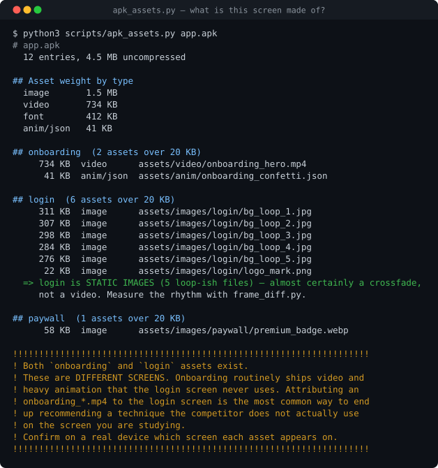
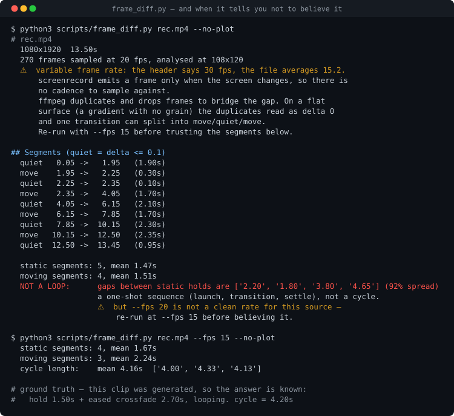
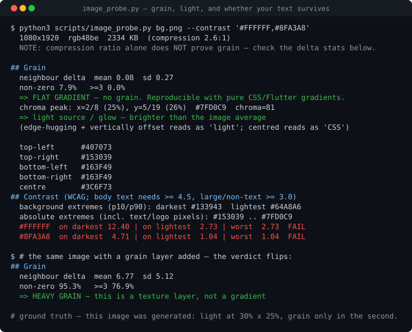

<div align="center">

# how-they-built-it

**你看到一个觉得好的界面或功能。它把那个东西实际是怎么做的测出来，
给你能照着做的数值和证据。**

Claude Code 与 Codex 插件 · 其他 Agent 读 `AGENTS.md` · 脚本是纯 Python

[English](README.md) · Android · iOS（通过 Apple Silicon Mac）· Web


</div>

---

## 为什么不能只靠看

靠看只能得出「它用了大图和柔和的光」——没人能照着做，而且**大概率是错的**。一段 2.7 秒的缓动交叉溶解，
肉眼会读成「每 2.5 秒换一张、淡入淡出 0.6 秒」，差了 4 倍，而且在有人去测之前就写进了设计文档。

| 你想知道 | 怎么回答 |
|---|---|
| 那个背景是视频、Lottie，还是五张 JPEG？ | 读安装包的资源清单（APK，或 Mac 上的 iPhone App） |
| 那个转场多长、什么曲线？ | 对录屏逐帧求差 |
| 有颗粒，还是能用 CSS 画？ | 相邻像素统计 |
| 我的文字放上去对比度够不够？ | 遍历所有像素取最小对比度 |
| 端侧还是云端？哪些 SDK 是买的？ | 包里的原生库、Dart 包、域名、接口路径 |
| 点下去到底会发生什么？ | 编号操作步骤，每步一张截图、一段录屏 |

测不了的一律标成推断。**这个区分就是重点。**

## 安装

**Claude Code**

```bash
claude plugin marketplace add DEOWL-kan/how-they-built-it
claude plugin install how-they-built-it@deowl-kan
```

**Codex**

```bash
codex plugin marketplace add DEOWL-kan/how-they-built-it
codex plugin add how-they-built-it@deowl-kan
```

装完新开一个会话。**其他 Agent**（Cursor、Windsurf、Gemini CLI、opencode、Amp 等）：clone 下来，让它读 `AGENTS.md`。
**不用 Agent**：每个脚本都有 `--help`。

依赖：Python 3.8+（只用标准库）和 `ffmpeg`/`ffprobe`；Android 真机还要 `adb`。没有要 `pip install` 的东西。
`python3 scripts/preflight.py` 会告诉你缺什么。

<details>
<summary>手动安装（clone + 软链，适合要改代码的人）</summary>

```bash
git clone https://github.com/DEOWL-kan/how-they-built-it.git
ln -s "$PWD/how-they-built-it" ~/.claude/skills/how-they-built-it
```

插件和软链二选一，别都装：会出现两份同样的 skill。
</details>

## 怎么用

不用记命令。说你想要什么，它听的是三个入口：

| 你说 | 你得到 |
|---|---|
| 「XYZ 的登录页怎么做的」「那个背景是视频吗」 | **拆一屏**：机制和能照着做的数值 |
| 「我要做空状态页，没思路」 | **三个参考**（web 和 App 混合）：各自怎么做、共同点与分歧、哪条适合你 |
| 「我们要做自动分章节，先调研」「他们的转写是端侧吗」 | **调研一个功能**：需求、编号操作路径、功能分析与技术剖解 |

可以直接粘贴的一句：

> 调研一下 XYZ 的语音笔记是怎么做的：按步骤配截图，每条结论标上证据，最后说我们能怎么做。

下载安装包、在别人 App 上操作（会产生真实数据、可能用掉免费额度）、提取对方资源之前，都会先问你。

## 产出长什么样

每条结论都带证据，报告最后说清哪些验证了、哪些只是推断、哪些没查。摘自[一个真实的网页案例](examples/web/wikipedia-case.md)：

| 结论 | 结果 |
|---|---|
| 输入框尺寸，以及输入时建议出现、清空后隐藏 | PASS（指定条件） |
| 上线脚本里声明了 100 ms 防抖 | PASS（静态范围） |
| 观测到的流程与完整客户端处理链一致 | PLAUSIBLE（响应到界面的映射有缺口） |
| 实际防抖时延、缓存、异常、服务端实现 | SKIP |

拆一屏时给的是测量值。问一个登录页是什么做的：



一直被当成视频，实际是五张 JPEG 加交叉溶解，约 1.2 MB，整个制作方案都不一样了。底下那段警告对应一个犯过两次的错：
把 `onboarding_*.mp4` 算到登录页头上。

<details>
<summary>动效节奏与像素分析</summary>



测得周期 4.13 秒，真值 4.20 秒。它也报出自己修不了的事：这段录屏是变帧率，0.7% 的样本像重复帧，低于会干扰分段的程度。



平坦渐变、无颗粒，用 CSS 画就行。白字在暗部通过（12.40），**在光斑上不通过（2.73）**。

</details>

> 图都是脚本的真实输出，输入是答案已知的合成样本：结论能对着真值核验，仓库里也不含任何竞品素材。
> 重新生成用 `./tools/make_figures.sh`。

## 证据规则

| 标签 | 含义 |
|---|---|
| `[device]` | 在设备上亲眼看到，附录屏和时间点 |
| `[browser]` | 在浏览器里观察到，页面或网络 |
| `[package]` | 追溯到具体文件。只证明**这些字节在包里**，不证明功能上线 |
| `[public-source]` | 官方声明，附链接和日期 |
| `[user-report]` | 某人的说法，附作者、链接和日期；未在这里复现 |
| `[inferred]` | 证据撑不住这句话，即使同时有好几个标签 |

结论分三态：**PASS**（验证了）、**PLAUSIBLE**（推断）、**SKIP**（没查）。架构结论（「他们的转写在云端」）
就算有两个标签也只能是 PLAUSIBLE：「没有端侧库」加「飞行模式下不可用」排除不了「本地推理但要联网校验」。
调研有目标深度 L1–L5，并记录实际达到的深度。

```bash
python3 scripts/check_report.py report.json                          # 结论对证据
python3 scripts/check_report.py report.json --walkthrough steps.json  # 每一步的证据
```

校验器会拒绝「推断记 PASS」「只有静态证据却记运行时 PASS」。它查结构和引用，不查事实。

## 手工跑

```bash
# Android
adb shell pm path com.example.app && adb pull <每个路径> .
python3 scripts/apk_assets.py base.apk --screen login          # 一屏是什么做的
python3 scripts/feature_probe.py *.apk --keyword transcri       # 一个功能是什么做的
python3 scripts/feature_probe.py *.apk --section dart           # Flutter：全部 Dart 包

# iOS：用户自己装在 Apple Silicon Mac 上的 iPhone App
python3 scripts/ios_bundle.py "/Applications/XYZ.app"
python3 scripts/feature_probe.py "/Applications/XYZ.app" --keyword transcri

# 动效、像素、操作路径
python3 scripts/frame_diff.py rec.mp4 --suggest-crop
python3 scripts/image_probe.py bg.png --grid 9x20 --contrast '#1E2C28'
python3 scripts/walkthrough.py steps.json --out /tmp/walkthrough
```

| 脚本 | 回答 |
|---|---|
| `preflight.py` | 缺什么（ffmpeg、adb、设备、可选工具），附安装提示 |
| `apk_assets.py` | 视频、Lottie 还是五张 JPEG？每个资源属于哪一屏？ |
| `apk_profile.py` | 包与 split 清单、Manifest 声明（可选 apkanalyzer） |
| `feature_probe.py` | 原生库、SDK、Dart 包、域名、接口路径、关键词；APK、随包 H5 或 iOS `.app` |
| `ios_bundle.py` | iOS 包的构成、Info.plist、隐私清单、框架、FairPlay 加密范围 |
| `frame_diff.py` | 多长、什么缓动、是否循环、哪里在动？ |
| `image_probe.py` | 颗粒还是渐变？光在哪？最小对比度？ |
| `web_probe.js` | 网页实际生效的 DOM、CSS、动画参数 |
| `tools/web-capture` | 实时 HTTP/WS/SSE 采集（可选，需要 Node + Playwright） |
| `walkthrough.py` | 编号步骤，每步一张截图一段录屏，输出 HTML 和 Markdown |
| `check_report.py` | 按上面的规则核对证据记录和操作路径 |
| `test_regressions.py` | 这个工具出过的每个 bug 一个样本，改完就跑 |

## 可选：配合 REA

[REA](https://github.com/morluto/rea) 是面向 Agent 的逆向工具。本技能不会自动安装它，[`references/rea.md`](references/rea.md)
写了什么时候交给它。实测下来最大的提升在**用 Interface Builder 做的 iOS 界面**：编译后的 nib 能解成控件树，带文字、字体、颜色、
约束和按钮方法名，标准库做不到。原生调用追踪（Ghidra）可能是第二处，未验证。Flutter 依赖清单则是我们自己的
`--section dart` 更全（同一个 App 上 138 个包，REA 是 27 个）。

## 做不到的

- **iOS** 只能读用户自己装在 Apple Silicon Mac 上的 iPhone App。Mac 上没有的 App、付费 App、设备侧（iPhone 录屏帧率、界面树、网络）
  未验证或做不到；Mac 副本可能是给 iPad 瘦身的。见 [`references/ios.md`](references/ios.md)。
- **字符串不等于功能。** 包只证明字节在里面，不证明功能上线。接口路径只认完整字符串，拼接出来的、压缩 JS 里的都看不到。
- **不拦截 App 网络。** 证书锁定和改客户端都在边界外；端侧还是云端，除非有别的证据，否则停在 PLAUSIBLE。
- **缓动转场时长读数偏短**（已知 2.7 秒读出 2.16–2.38 秒），周期更稳。重采样的录屏会有重复帧，工具会报出来，但不修复。
- **对比度要喂背景图**，不是截图；有蒙层时不是线上值。
- **「帮我找」从没完整跑过**，功能调研的真机实跑只有一次。

当前状态和全部已知缺口见 [`ROADMAP.md`](ROADMAP.md)。

## 边界

这是为了理解**机制**、把自己的东西做得更好，不是拿别人的成果。

| | |
|---|---|
| 分析时长、颜色、结构、资源类型 | ✅ |
| 把发现变成自己的规格并自己实现 | ✅ |
| 截图和抽帧用于分析 | ✅ 标注出来 |
| 从公开渠道下载免费安装包 | ⚠️ 先征求同意，再核对版本 |
| 读用户自己装在 Mac 上的 iPhone App | ✅ 只读明文文件；不碰 FairPlay 加密段，不读购买信息 |
| 登录用户的商店账号 | ⛔ 绝不 |
| 付费或锁区的 App | ⛔ 绝不 |
| 把竞品素材放进我方产品或提交进仓库 | ⛔ 绝不 |
| 绕付费墙、改客户端、Frida、规避 DRM | ⛔ 绝不 |

## 凭什么信它

- **45 个回归样本**，每个 bug 一个，都验证过去掉修复会失败：`python3 scripts/test_regressions.py`。
- **[40 条踩坑](references/pitfalls.md)**，几乎都是真实犯过的错，包括脚本自己的：一个 `ble` 子串匹配上了 `drawable`，把 2886 个资源里的 1976 个塞进了错的桶。
  其中两条记录的是我们自己的错误修复，后来撤回了。
- **触发准确率是实测的**：调参集 35/36，留出集 10/12；第二份 20 条留出集已起草、还没跑。无真机验证见[记录](evals/validation-2026-10-08.md)。

## 更新

| 安装方式 | 更新命令 |
|---|---|
| Claude Code 插件 | `claude plugin marketplace update deowl-kan`，再 `claude plugin update how-they-built-it@deowl-kan`（或在 `/plugin` 里开自动更新） |
| Codex 插件 | `codex plugin marketplace upgrade deowl-kan` |
| clone + 软链 | `git -C <clone 目录> switch main && git -C <clone 目录> pull --ff-only` |

然后新开会话。改了什么见 [`CHANGELOG.md`](CHANGELOG.md)。插件按版本号判断有没有更新。

## 常见问题

<details><summary>支持 iOS 吗？</summary>

部分支持。App 在 Mac App Store 上有 iPhone 版的话，用户自己装上，脚本就能读它的包；否则只剩录屏和像素分析。见 `references/ios.md`。
</details>

<details><summary>一定要真机吗？</summary>

不用。网页产品、安装包、录屏都不需要真机，只是运行时的结论会停在 SKIP。
</details>

<details><summary>它会自己下载东西、动我的账号吗？</summary>

不会自己动手。下载安装包、操作 App 之前都会问你，也绝不登录商店账号。
</details>

<details><summary>为什么 SKILL.md 是中文？</summary>

最初就是用中文写的。`AGENTS.md` 用英文写了同样的规则，Agent 两份都读。references 和 examples 大多是中文。
</details>

## 文档

[`SKILL.md`](SKILL.md) 流程 · [`AGENTS.md`](AGENTS.md) 给任何 Agent 的规则 ·
[`references/`](references/)：`pitfalls`、`feature-research`、`research-workflow`、`evidence-format`、
`android`、`ios`、`web`、`apk-analysis`、`code-tracing`、`rea` ·
[`examples/`](examples/)（中文）· [`CONTRIBUTING.md`](CONTRIBUTING.md) · [`CHANGELOG.md`](CHANGELOG.md)

## 许可

MIT，见 [LICENSE](LICENSE)。
